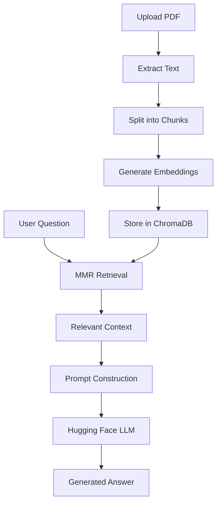

# 📚 PDF RAG Chatbot

A **Retrieval-Augmented Generation (RAG)** application that lets you upload PDF documents and ask questions about their content. The application extracts text, splits it into chunks, generates embeddings, stores them in ChromaDB, retrieves relevant information, and generates context-aware responses using a Hugging Face-hosted LLM.

## ✨ Features

- 📄 **Chat with PDFs** — Ask questions in natural language about your uploaded documents.
- 🔍 **Document Processing** — Extract text from PDFs using PyMuPDF.
- ✂️ **Text Chunking** — Split text into manageable overlapping chunks.
- 🧠 **Semantic Embeddings** — Generate embeddings using `sentence-transformers/all-MiniLM-L6-v2`.
- 🗄️ **Vector Database** — Store and retrieve document embeddings with ChromaDB.
- 🎯 **MMR Retrieval** — Retrieve relevant and diverse context using Maximal Marginal Relevance.
- 🤖 **Context-Grounded Answers** — Generate answers based on retrieved document content.
- 💬 **Interactive Chat UI** — Chat with your documents through Streamlit.
- 💾 **Persistent Knowledge Base** — Reload previously indexed documents without rebuilding.

## 🛠️ Tech Stack

| Technology | Purpose |
|---|---|
| Python | Programming language |
| LangChain | RAG pipeline and orchestration |
| PyMuPDF | PDF text extraction |
| RecursiveCharacterTextSplitter | Document chunking |
| Hugging Face | LLM inference |
| Sentence Transformers | Embeddings |
| ChromaDB | Vector storage |
| Streamlit | Web interface |
| uv | Python package and environment management |

## 🧠 RAG Architecture



### How it works

**1. Document Ingestion**
- Upload a PDF document.
- Extract its text and page metadata using PyMuPDF.

**2. Text Chunking**
- Split extracted text into smaller chunks using `RecursiveCharacterTextSplitter`.
- Chunk size: `1000`
- Chunk overlap: `200`

**3. Embedding Generation**
- Convert text chunks into numerical vector representations.
- Embedding model: `sentence-transformers/all-MiniLM-L6-v2`

**4. Vector Storage**
- Store embeddings and document chunks in ChromaDB.
- Persist the database locally in `chroma_db/`.

**5. Retrieval**
- Retrieve relevant document chunks using MMR (Maximal Marginal Relevance).
- Balance relevance and diversity to reduce repetitive context.

**6. Response Generation**
- Pass retrieved context and the user's question to the language model.
- Generate an answer grounded in the document context.

## 📂 Project Structure

```text
RAG-Project/
│
├── document loaders/       # Sample documents and loader experiments
├── retrievers/             # Retrieval experiments (MMR, arXiv)
├── src/                    # Source package
├── vector store/            # Vector database experiments
│
├── app.py                  # Streamlit RAG chatbot
├── create_database.py       # Create vector database from PDF
├── main.py                 # CLI-based RAG chatbot
├── mainduplicate.py         # Experimental script
│
├── pyproject.toml           # Project configuration
├── requirements.txt          # Dependencies
├── uv.lock                 # Locked dependencies
└── README.md
```

## ⚙️ Installation & Setup

### 1. Clone the repository

```bash
git clone https://github.com/anurag70508/RAG-Project.git
cd RAG-Project
```

### 2. Install Python

Ensure you have Python **3.13 or newer** installed.

### 3. Install uv

Install uv if you haven't already:

[Install uv](https://docs.astral.sh/uv/getting-started/installation/)

### 4. Install dependencies

```bash
uv sync
```

### 5. Configure environment variables

Create a `.env` file in the project root and add your Hugging Face token:

```env
HUGGINGFACEHUB_API_TOKEN=your_huggingface_token
```

> Keep your API token private. Never commit your `.env` file to GitHub.

## 🚀 Run the Application

Launch the Streamlit interface:

```bash
uv run streamlit run app.py
```

Open the local URL provided in the terminal to access the application.

## 📖 Usage

1. Launch the application.
2. Upload your PDF from the sidebar.
3. Click **Build knowledge base**.
4. Wait for the document to be processed and indexed.
5. Ask questions using the chat input.
6. View answers generated from the document context.
7. Use **Clear chat** to reset your conversation.

You can also load a previously created ChromaDB knowledge base using **Load existing knowledge base**.

## 💻 CLI Mode

This project also supports command-line interaction.

### Create the vector database

```bash
uv run python create_database.py
```

This indexes the configured PDF and stores its embeddings in `chroma_db/`.

### Start the CLI chatbot

```bash
uv run python main.py
```

Ask questions directly in the terminal.

Enter `0` to exit the chatbot.

## 🔎 Retrieval Configuration

The application uses ChromaDB's MMR retriever.

| Parameter | Value | Description |
|---|---:|---|
| `k` | 4 | Number of chunks returned |
| `fetch_k` | 10 | Candidate chunks considered for retrieval |
| `lambda_mult` | 0.5 | Relevance vs. diversity balance |


---

⭐ If you find this project useful, consider starring the repository!
